# Proyecto Final MLOps — Precio de vivienda (grupo 2)

Pontificia Universidad Javeriana · Operación de Aprendizaje de Máquinas · Nivel 4
**Equipo:** Daniel Niño (carril B: datos, ML y aplicación) · Ana María Merchán (carril A: infraestructura y plataforma)
**Video de sustentación:** _[enlace de YouTube]_

Un sistema MLOps que consume lotes de datos inmobiliarios uno por uno. En cada lote decide **si reentrenar**, y
promueve el modelo nuevo **solo si le gana al que está en producción**. La API de inferencia toma siempre el modelo
productivo desde MLflow y lo cambia sin redesplegarse. Todo corre en Kubernetes, desplegado con Argo CD a partir de
imágenes que construye GitHub Actions.

Este README es el informe del proyecto: cuenta qué hicimos, en qué orden, qué decidimos y por qué, qué problemas
aparecieron y qué observamos. Cada afirmación importante tiene su evidencia (captura o archivo con salidas reales).

---

## Contenido

1. [Arquitectura](#1-arquitectura)
2. [Resultado en una tabla](#2-resultado-en-una-tabla)
3. [Bitácora del desarrollo](#3-bitácora-del-desarrollo)
4. [Datos: lo que encontramos en la API](#4-datos-lo-que-encontramos-en-la-api)
5. [DAG de Airflow](#5-dag-de-airflow)
6. [Validación, drift y decisión de entrenamiento](#6-validación-drift-y-decisión-de-entrenamiento)
7. [Análisis por lote](#7-análisis-por-lote)
8. [MLflow y promoción de modelos](#8-mlflow-y-promoción-de-modelos)
9. [API de inferencia (FastAPI)](#9-api-de-inferencia-fastapi)
10. [Streamlit](#10-streamlit)
11. [CI/CD con GitHub Actions](#11-cicd-con-github-actions)
12. [Kubernetes y Argo CD](#12-kubernetes-y-argo-cd)
13. [Observabilidad y prueba de carga](#13-observabilidad-y-prueba-de-carga)
14. [Cómo ejecutarlo](#14-cómo-ejecutarlo)
15. [Estructura del repositorio](#15-estructura-del-repositorio)
16. [Requerimientos del enunciado y dónde se cumplen](#16-requerimientos-del-enunciado-y-dónde-se-cumplen)

---

## 1. Arquitectura

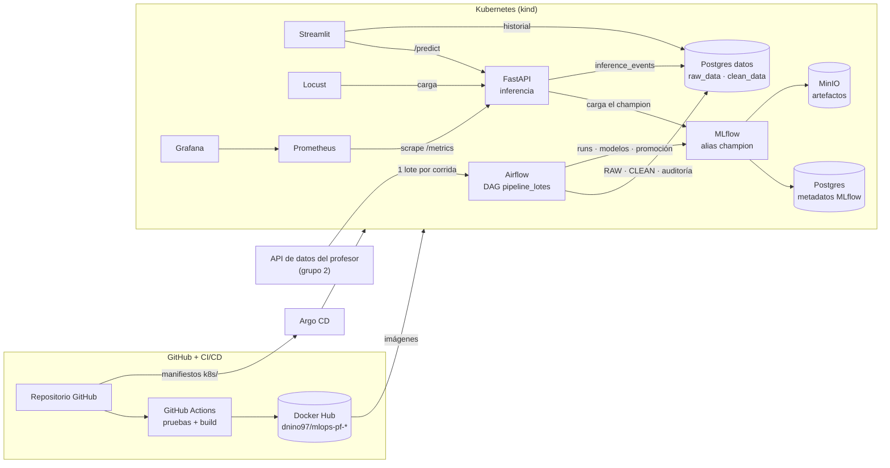

**Flujo:** GitHub guarda el código, los DAGs y los manifiestos. GitHub Actions prueba y publica las imágenes en Docker
Hub, y Argo CD sincroniza `k8s/` con el clúster. Dentro del clúster, Airflow pide un lote por corrida, lo guarda en
RAW, lo valida, lo limpia en CLEAN y decide si entrena. Si entrena, registra el candidato en MLflow, lo compara contra
el campeón y lo promueve o lo rechaza. La API carga siempre el modelo con alias `champion`, Streamlit muestra
predicciones e historial, y Prometheus/Grafana observan la API mientras Locust le aplica carga.

**Por qué estos componentes:** dos Postgres separados, uno para los datos del pipeline (bases `raw_data` y
`clean_data`) y otro para los metadatos de MLflow, para que los dominios no se mezclen. MinIO es compatible con S3 y
corre dentro del clúster. Airflow usa `LocalExecutor`, porque las tareas comparten un directorio de staging donde
viaja el lote (hasta 60 MB, demasiado para XCom).

---

## 2. Resultado en una tabla

Así quedó la corrida completa de los 6 lotes del grupo 2 (`audit.batch_history`):

| Lote | Filas | ¿Entrenó? | Por qué | ¿Promovido? | Resultado |
|---|---|---|---|---|---|
| 0 | 73.784 | Sí | Línea base: no existía modelo productivo | Sí | v1 |
| 1 | 94.551 | Sí | Drift en `house_size` (PSI 12,5), 5 % de ciudades nuevas, +128 % de volumen | Sí | v2 (MAE −7,6 %) |
| 2 | 230.366 | Sí | Volumen +137 % (sin drift) | Sí | v3 (MAE −7,7 %) |
| 3 | 4.055 | **No** | **Lote insuficiente (+1 %), aunque hubo drift y un estado nuevo** | — | alertas registradas |
| 4 | 320.696 | Sí | Drift en `price` (PSI 12,2); el campeón empeoró su MAE +316 % sobre el lote | Sí | v4 (MAE −44,8 %) |
| 5 | 361.457 | Sí | Drift en `price` (PSI 12,3); el campeón empeoró su MAE +1.414 % | Sí | v5 (MAE −51,5 %) |
| — | — | — | La API respondió que ya no hay más lotes | — | fin normal |

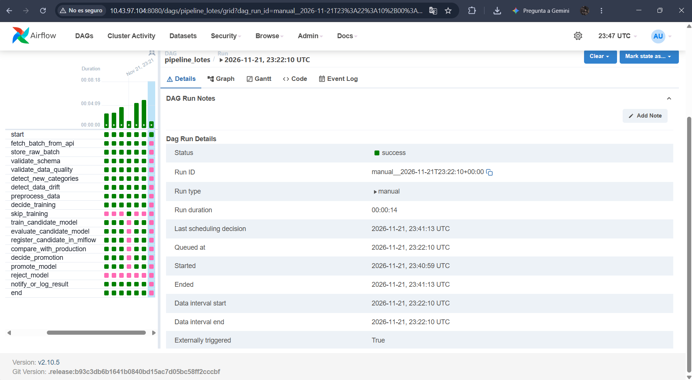
_Grilla de Airflow con las 7 corridas, una por lote más la de fin de datos. En verde, la rama que se ejecutó; en
rosado, la que no. En la 4.ª columna (lote 3) se ve `skip_training`, y en las demás `promote_model`._

La corrida en Airflow dio **exactamente** las mismas decisiones y métricas que una simulación previa por script: el
pipeline es reproducible.

---

## 3. Bitácora del desarrollo

El trabajo se dividió en dos carriles: **A**, la plataforma (clúster, Argo CD, bases, MinIO, MLflow, Airflow,
manifiestos y observabilidad), y **B**, lo que corre sobre ella (DAG, datos, modelo, API, Streamlit y Locust). El
carril B se desarrolló primero en un `docker compose` **solo de desarrollo** (`dev/`), para avanzar sin esperar el
clúster; ese compose no es el despliegue. Cada fase cerró con pruebas, un README de evidencia y un commit.

| Fase | Qué se hizo | Problema o hallazgo | Cómo se resolvió |
|---|---|---|---|
| B0 Entorno | Estructura del repo y compose de desarrollo (Postgres ×2, MinIO, MLflow, API de datos) | `minio/minio` y `minio/mc` **ya no existen en Docker Hub** | Se usó `coollabsio/minio` (probada en clase), y el bucket lo crea un script con boto3 |
| B1 API de datos | Exploración de la API y cliente con reintentos | Los lotes pesan hasta 360 mil filas; el fin de datos llega como HTTP 400 | Timeout de lectura de 120 s; el 400 se convierte en `NoMoreBatches` (fin normal) |
| B2 RAW | Tablas e ingesta idempotente | Insertar fila por fila tardaba minutos | `COPY` en una transacción: el lote de 230 mil filas entra en ~10 s |
| B3 Validación | Esquema, calidad, categorías nuevas, drift y CLEAN | Un PSI de ~12 parecía un error de cálculo | Diagnóstico por tramos: **la API corta los lotes por rangos**. Es drift real |
| B4 Modelo | Entrenamiento, MLflow, reglas de decisión y promoción | El lote 3 tiene drift pero solo 4 mil filas | Puerta de volumen mínimo: una alerta no obliga a reentrenar |
| B5 DAG | DAG de 19 tareas en Airflow | El lote no cabe en XCom | Se guarda en un directorio de staging y por XCom van solo resúmenes |
| B6 API | FastAPI con recarga desde MLflow | ~230 ms por predicción | Medición por partes y `FastPredictor`: ~25 ms con la misma predicción |
| B7 Streamlit y Locust | Interfaz de inferencia e historial, prueba de carga | La latencia sube bajo carga con 1 proceso | Se escala con réplicas en Kubernetes (ver §13) |
| B8 Alertas | Alertas de drift siempre registradas (variación y rango, además de PSI) | Hacía falta distinguir alerta de reentrenamiento | Campo `alertas` en la auditoría, `log.warning` en Airflow y aviso en Streamlit |
| Plataforma | _[carril A: clúster, Argo CD, manifiestos, Prometheus y Grafana]_ | _[problemas encontrados]_ | _[cómo se resolvieron]_ |

**Otro problema de entorno:** la partición `/var` de la VM (15 GB) se llenó al construir la imagen de Airflow. Se
movió el almacenamiento de Docker a `/opt`, en la partición raíz.

Evidencia detallada de cada fase, con salidas reales:
[B0](docs/evidencias/carril-b/b0-entorno/README.md) ·
[B1](docs/evidencias/carril-b/b1-api-datos/README.md) ·
[B2](docs/evidencias/carril-b/b2-raw/README.md) ·
[B3](docs/evidencias/carril-b/b3-validacion-clean/README.md) ·
[B4](docs/evidencias/carril-b/b4-modelo-mlflow/README.md) ·
[B5](docs/evidencias/carril-b/b5-dag/README.md) ·
[B6](docs/evidencias/carril-b/b6-fastapi/README.md) ·
[B7](docs/evidencias/carril-b/b7-streamlit-locust/README.md)

---

## 4. Datos: lo que encontramos en la API

Antes de diseñar el pipeline exploramos la API ([evidencia B1](docs/evidencias/carril-b/b1-api-datos/README.md)):

- **6 lotes por grupo** (`batch_number` 0 a 5, ~1,08 millones de filas). Al acabarse, la API responde **HTTP 400**
  con *"Ya se recolectó toda la información minima necesaria"*. El DAG lo trata como **fin normal**, no como error.
- **La API es determinista:** después de reiniciar devuelve exactamente los mismos datos.
- **Los lotes vienen cortados por rangos**, y eso genera drift real y extremo
  ([diagnóstico B3](docs/evidencias/carril-b/b3-validacion-clean/README.md)):
  - el lote 0 tiene `house_size` ≥ 1.500 y el lote 1, < 1.500;
  - los lotes 0–3 tienen precio ≤ 300 mil, el lote 4 entre 300 y 500 mil, y el lote 5 por encima.
- **Imagen usada:** `cristiandiaz13/mlops-puj:data-api-pf-v2`, la que indica el enunciado del proyecto.

**RAW y CLEAN están separados en dos bases:**

- `raw_data` guarda cada registro tal como llegó (JSONB), más los metadatos del lote: número, fecha, filas y hash.
  Un lote ya guardado no se vuelve a insertar (llave única `group_number` + `batch_number`).
- `clean_data` guarda los datos tipados y limpios. Cada fila conserva `raw_row_id` y `batch_id` para rastrear su
  origen.

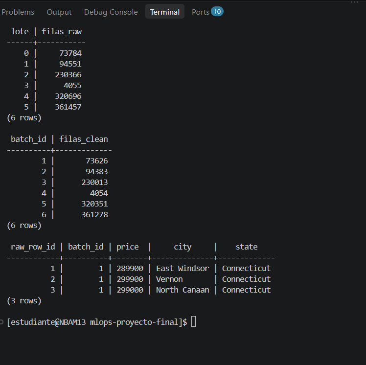
_Filas por lote en RAW y en CLEAN, y la fila `raw_row_id = 1` en las dos bases: el registro de East Windsor
(Connecticut) se conserva sin cambios en RAW y tipado en CLEAN._

---

## 5. DAG de Airflow

`airflow/dags/pipeline_lotes.py` tiene **19 tareas en el orden del enunciado** y **dos bifurcaciones**:

```
start → fetch_batch_from_api → store_raw_batch → validate_schema → validate_data_quality
      → detect_new_categories → detect_data_drift → preprocess_data → decide_training
          ├─ skip_training ───────────────────────────────────────────────┐
          └─ train_candidate_model → evaluate_candidate_model             │
             → register_candidate_in_mlflow → compare_with_production     │
             → decide_promotion ─┬─ promote_model ──────────────────────┤
                                  └─ reject_model ───────────────────────┤
                                                    notify_or_log_result → end
```

- **Una petición = un lote = una corrida completa.** No se descargan todos los lotes de una vez.
- Cada tarea llama **una sola función** de `airflow/dags/lib/`, que tiene pruebas con pytest.
- **Cliente de la API** (`lib/api_client.py`): timeout, reintentos con espera creciente solo para errores
  transitorios, validación de la respuesta, lote vacío y fin de datos.
- **Robustez:** reintentos en la tarea de red; `max_active_runs=1`; un lote duplicado no se reprocesa; el fin de
  datos deja la corrida en `skipped`; y cualquier error real queda en el historial como `fallido` (callback de fallo),
  nunca disfrazado de éxito.

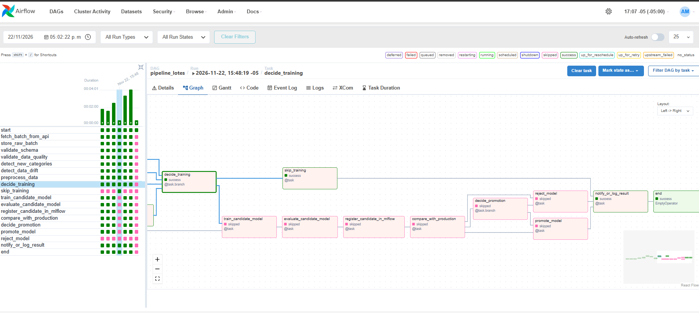
_Grafo del DAG con las 19 tareas y las dos bifurcaciones (`decide_training` y `decide_promotion`)._

---

## 6. Validación, drift y decisión de entrenamiento

Detalle completo y justificación de cada umbral: **[docs/decisiones.md](docs/decisiones.md)**.

**Validaciones de cada lote:** esquema (columnas faltantes o extra, tipos), calidad (nulos, duplicados, rangos,
precio fuera de [1.000, 100.000.000]), volumen frente al acumulado, categorías nuevas en `state`, `city` y `status`,
y drift contra el histórico de CLEAN.

**Medidas de drift por variable** (`price`, `house_size`, `acre_lot`, `bed`, `bath`):

| Medida | Umbral de alerta | Por qué |
|---|---|---|
| PSI | > 0,2 | Convención: < 0,1 estable, 0,1–0,2 moderado, > 0,2 significativo |
| KS (estadístico) | solo se reporta | Con cientos de miles de filas, el p-valor casi siempre sale significativo |
| `std_ratio` (dispersión del lote / histórico) | > 2 o < 0,5 | Cambia los extremos aunque la mediana se mantenga |
| Fuera del rango p1–p99 del histórico | > 10 % del lote | Si el lote se parece al histórico se espera ~2 %; más obliga a extrapolar |

**Categorías nuevas:** el modelo nunca falla ante una ciudad, zip o estado no vistos. `TargetEncoder` les asigna la
media global y `OneHotEncoder(handle_unknown="ignore")` las ignora.

**Regla de entrenamiento** (`lib/decision.py`): las alertas se registran **siempre**. Para entrenar, el lote además
debe aportar al menos **5 % del acumulado**. Si lo aporta, entrena cuando hay al menos un disparador: drift,
categorías nuevas en ≥ 5 % de las filas, volumen ≥ 10 % o degradación del campeón ≥ 10 % en MAE. **Nunca se entrena
por calendario ni por número de lotes.** La razón queda en la auditoría y como tag `train_reason` del run de MLflow.

### Ejemplo: lote 3, una alerta no es lo mismo que reentrenar

El lote 3 tiene 4.054 filas (+1,02 % del acumulado), un PSI de 0,41 en `price` y **Massachusetts, un estado nuevo, en
el 100 % de sus filas**. Se generan las alertas y se registran en Airflow y en Streamlit, pero **no se entrena**: con
4 mil filas de un solo estado, un candidato sería casi igual al campeón y su test casi el mismo. Sus datos quedan en
CLEAN y entran en el siguiente entrenamiento (v4 se entrenó con los lotes 0-1-2-3-4).

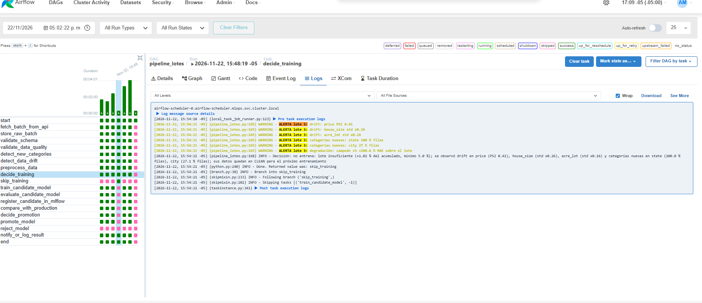
_Log de `decide_training` en la corrida del lote 3: las líneas `ALERTA lote 3` (drift en `price`, estado nuevo) y
la decisión «no entrena: lote insuficiente»._

---

## 7. Análisis por lote

_[Completar con los valores de `audit.batch_history` de la corrida final: para cada lote, qué llegó, qué alertas
hubo, qué se decidió y las métricas frente al campeón.]_

**Lote 0.** 73.784 filas de 50 estados, todas con `house_size` ≥ 1.500. Sin referencia previa, así que no hay drift
que medir. Entrena la línea base (v1, MAE de test ~40 mil) y se promueve porque no existía modelo productivo.

**Lote 1.** 94.551 filas, **todas con `house_size` < 1.500**: el lote completo cae fuera del rango del histórico
(PSI 12,5). Además, 5,2 % de las filas son de ciudades nuevas y el volumen crece +128 %. Entrena v2 y, sobre el mismo
test, baja el MAE 7,6 % frente a v1 → se promueve.

**Lote 2.** 230.366 filas, sin drift (PSI máximo 0,004). Entrena solo por volumen (+137 %). v3 mejora el MAE 7,7 %
frente a v2 → se promueve. Más datos de la misma distribución siguen ayudando.

**Lote 3.** Ver el ejemplo de §6: alertas registradas y no entrena.

**Lote 4.** 320.696 filas con **precios entre 300 y 500 mil**, por encima de todo lo visto (PSI 12,2). El campeón v3
empeora su MAE **+316 %** sobre este lote: un modelo de árboles no extrapola a precios que nunca vio. v4 baja el MAE
44,8 % frente a v3 sobre el mismo test → se promueve.

**Lote 5.** 361.457 filas con precios **por encima de 500 mil** (mediana ~760 mil). El campeón v4 empeora +1.414 %.
v5 baja el MAE 51,5 % → se promueve.

**Fin de datos.** La 7.ª corrida recibe el HTTP 400 de la API, termina en `skipped` y queda registrada como
`sin_datos`.

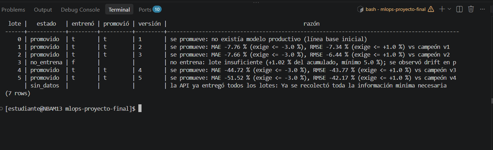
_`audit.batch_history` después de la corrida completa: estado final, si entrenó y se promovió, versión, Δ MAE y
alertas por lote._

---

## 8. MLflow y promoción de modelos

- **Modelo:** `TransformedTargetRegressor(log1p)` + `HistGradientBoostingRegressor`. El log reduce el efecto de los
  precios extremos, y el boosting de histogramas entrena rápido con un millón de filas.
- **Encoders:** `TargetEncoder` para `city`, `state`, `zip_code` y `brokered_by` (decenas de miles de categorías: un
  one-hot sería inviable) y `OneHotEncoder(handle_unknown="ignore")` para `status`. Se descarta `street`, que es casi
  un identificador único.
- **Cada run registra:** lotes usados, commit (`git_sha`), razón del entrenamiento, parámetros del modelo y del
  preprocesamiento, métricas de train/val/test (MAE, RMSE, R², MAPE), gráficos (real vs. predicho, residuales,
  importancia por permutación) y el modelo en formato MLflow con firma.
- **Infraestructura:** metadatos en Postgres (no SQLite) y artefactos en el bucket `mlflow-artifacts` de MinIO.
- **Producción:** el modelo registrado `house-price-model` con **alias `champion`**.

**Regla de promoción:** se promueve si el **MAE baja al menos 3 %** y el **RMSE no empeora más de 1 %**. El MAE es
la métrica principal porque se lee directo en dólares («nos equivocamos en $X en promedio»). El RMSE funciona como
freno: impide promover un modelo con errores grandes más frecuentes. El MAPE se descartó como criterio porque se
dispara con los precios bajos.

**Comparación justa:** el campeón se evalúa sobre **el mismo conjunto de test** del candidato. Además, el split es
determinista (`raw_row_id % 100`: 70 % train, 15 % val, 15 % test), así que una fila siempre cae en el mismo
conjunto y el campeón nunca vio el test del candidato.

### ¿Por qué el `test_mae` sube de v3 a v5 si cada versión se promueve?

| Versión | Lotes | test_mae |
|---|---|---|
| v3 | 0-1-2 | ~35 mil |
| v4 | 0-1-2-3-4 | ~47 mil |
| v5 | 0-…-5 | ~129 mil |

El test **crece con cada lote** e incluye casas cada vez más caras: el lote 5 trae precios por encima de 500 mil
(mediana ~760 mil). Un error de 129 mil sobre casas de 760 mil es proporcionalmente menor que uno de 35 mil sobre
casas de 200 mil. Por eso las cifras de distintas versiones no se comparan entre sí. **Lo que decide la promoción es
la comparación sobre el mismo test:** v5 tiene un MAE 51,5 % menor que v4 sobre ese mismo conjunto.

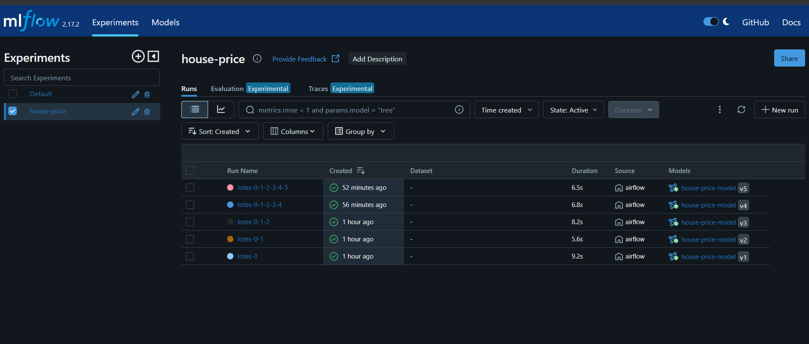
_Runs del experimento `house-price`: un run por entrenamiento, con los lotes usados, la razón y las métricas de test._

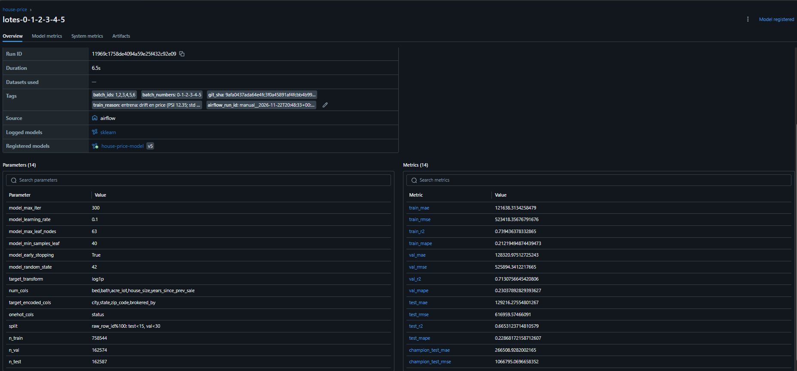
_Detalle de un run: tags `batch_numbers`, `git_sha` y `train_reason`, parámetros del modelo y gráficos guardados
en MinIO._

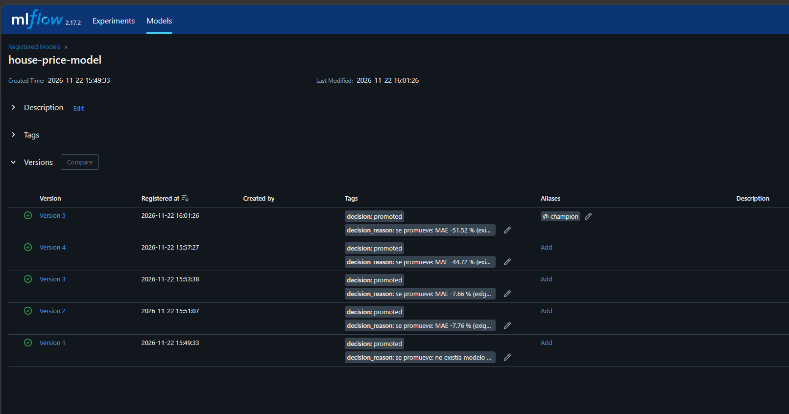
_Model Registry de `house-price-model`: versiones 1 a 5, cada una con su tag `decision`, y el alias `champion` en la
versión productiva._

---

## 9. API de inferencia (FastAPI)

Endpoints: `/live`, `/health`, `/predict`, `/metrics` y `POST /admin/reload` (protegido con un token guardado en un
Secret). Entrada validada con Pydantic. [Evidencia B6](docs/evidencias/carril-b/b6-fastapi/README.md).

- **MLflow como fuente de verdad:** la API carga `models:/house-price-model@champion`. No hay rutas, archivos ni
  versiones escritas en el código.
- **Recarga sin redespliegue (RF7):** un hilo revisa el alias cada 30 s y `/admin/reload` fuerza la revisión. El
  modelo nuevo se carga aparte y se intercambia con un lock solo cuando está completo, así que una petición nunca
  usa un modelo a medio cargar; las peticiones en curso terminan con el modelo con el que empezaron. Si la descarga
  falla, se queda el modelo anterior y el error se ve en `/health` y en la métrica `model_reload_total{result="error"}`.
- **Registro de inferencias (RF8):** cada petición (ok, inválida o con error) queda en `raw_data.inference_events`
  con fecha, entrada, predicción, versión, estado, error y latencia.
- **Optimización:** la primera versión tardaba ~230 ms por predicción. Medimos cada paso y el 90 % era el
  `TargetEncoder` de scikit-learn, que reconstruye en cada llamada un diccionario con todas las categorías.
  `FastPredictor` arma esos diccionarios una sola vez al cargar el modelo: **~25 ms, con exactamente la misma
  predicción** (verificado con pruebas).

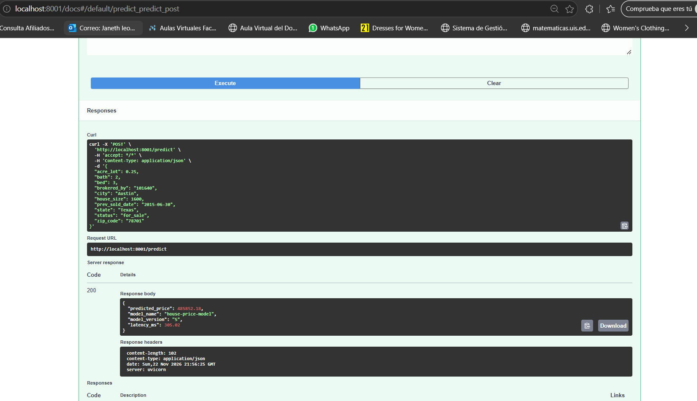
_`/docs` de la API: una predicción con su `model_version`._

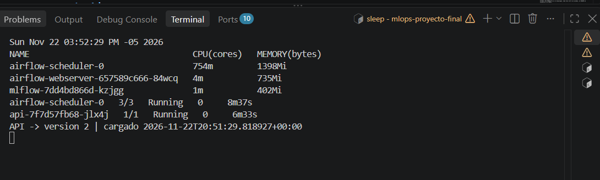
_Al mover el alias en MLflow, la API pasa de v5 a v4 y de vuelta a v5. El pod mantiene la misma edad y no se
reinicia._

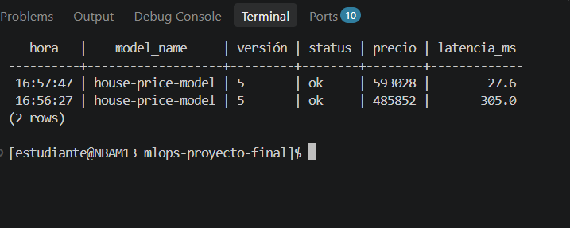
_`inference_events`: predicciones con v5 y con v4, una petición inválida con su error de validación, y la latencia
de cada una._

---

## 10. Streamlit

Dos pestañas ([evidencia B7](docs/evidencias/carril-b/b7-streamlit-locust/README.md)):

- **Inferencia:** un formulario que llama a la API y muestra el precio estimado, **la versión del modelo usada** y
  la latencia.
- **Historial de entrenamiento y despliegue:** una frase por lote (si entrenó o no, por qué, si se promovió),
  contadores, alertas de drift, la gráfica del MAE del candidato contra el campeón y la tabla con los IDs de MLflow.

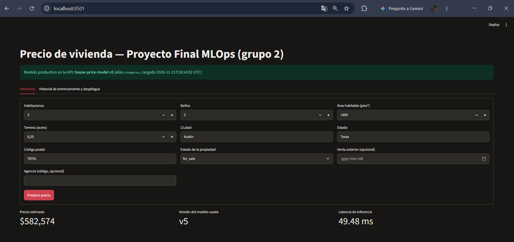
_Predicción de una casa en Austin (Texas) con el modelo v5, servida por la API._

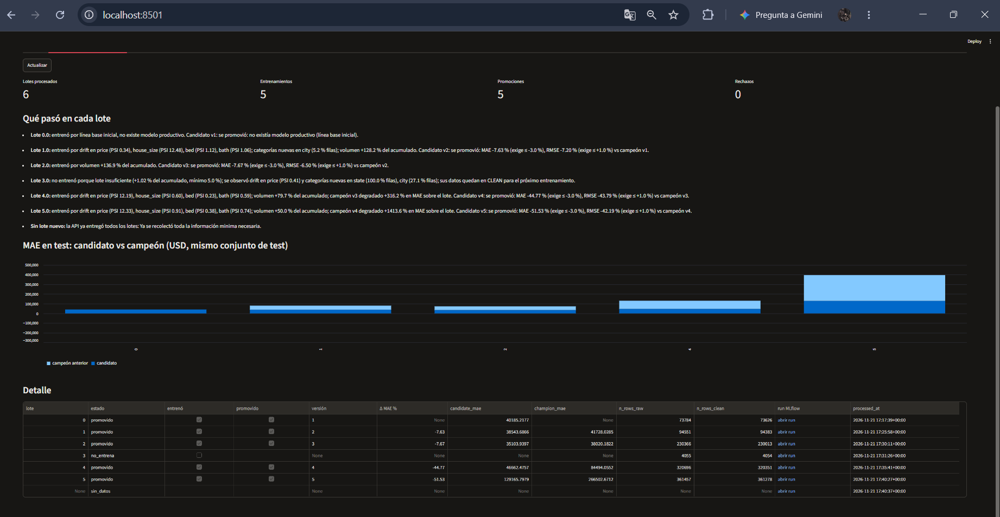
_Historial de los 6 lotes: 5 entrenamientos promovidos, el lote 3 con alertas y sin reentrenar, y el fin de datos._

---

## 11. CI/CD con GitHub Actions

Hay cuatro workflows en `.github/workflows/`, uno por imagen propia. Cada uno **corre las pruebas antes de
construir**; si fallan, no se publica nada. Las imágenes se publican en Docker Hub con dos etiquetas: el **SHA del
commit** (versión exacta) y `latest`. Las credenciales están en los secrets del repo.

| Imagen | Workflow | Pruebas previas |
|---|---|---|
| `dnino97/mlops-pf-airflow` | `airflow-image.yml` | `lib/` del DAG (cliente, validaciones, decisión) |
| `dnino97/mlops-pf-api` | `api-image.yml` | API, paridad de features con el DAG, FastPredictor |
| `dnino97/mlops-pf-streamlit` | `streamlit-image.yml` | narración del historial |
| `dnino97/mlops-pf-locust` | `locust-image.yml` | — |


_Ejecuciones de los cuatro workflows en verde._


_Tags de una imagen en Docker Hub: `latest` y el SHA de cada commit._

---

## 12. Kubernetes y Argo CD

_[Sección del carril A: cómo se crea el clúster; la Application de Argo CD (app-of-apps, sincronización
`automated`); los manifiestos en `k8s/` con `resources.requests`/`limits` en cada contenedor y por qué esos valores;
probes, Secrets, PVC y ConfigMaps. La API de datos también corre en el clúster.]_


_[pie]_


_[pie: qué se cambió en Git (por ejemplo, el tag de la imagen de la API) y cómo Argo CD lo aplicó]_


_[pie]_


_[pie: `kubectl top pods` o `kubectl describe` mostrando requests y limits]_

---

## 13. Observabilidad y prueba de carga

La API expone estas métricas: `predict_requests_total{status}` (ok, invalid, error), `predict_latency_seconds`
(histograma), `model_version`, `model_loaded` y `model_reload_total`.

**Prueba local previa** (30 usuarios, 60 s, 1 réplica): 1.118 predicciones, **0 fallos**, ~19 predicciones/s,
mediana de 120 ms y p95 de 480 ms. El contador de Prometheus subió exactamente lo mismo que Locust (+1.118). Con un
solo proceso, las peticiones simultáneas hacen cola: la latencia sube aunque no haya errores. La API usa 1 worker a
propósito, para que el modelo y las métricas vivan en un solo proceso, y se escala con **réplicas en Kubernetes**.

_[Prueba en el clúster: Locust con 1 réplica y luego con varias. Análisis de lo observado en Grafana (peticiones/s,
latencia p50/p95, errores, CPU y memoria del pod frente a sus limits) y conclusión sobre los recursos.]_


_[pie]_

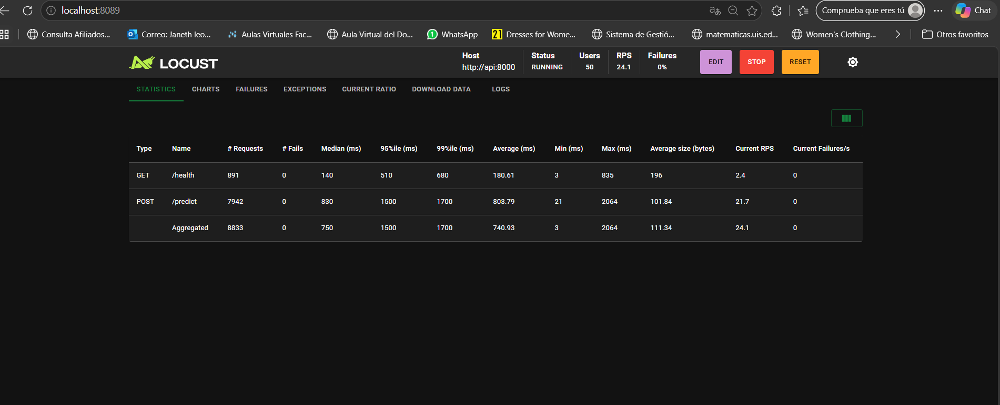
_[pie: usuarios, RPS y fallos]_


_[pie: qué se ve al subir la carga y al escalar réplicas]_

---

## 14. Cómo ejecutarlo

**En Kubernetes** _(carril A)_: _[pasos para crear el clúster, instalar Argo CD y aplicar la Application raíz]_.

**Entorno local de desarrollo** (solo para desarrollar y probar el carril B; no es el despliegue):

```bash
cp dev/.env.example dev/.env          # completar contraseñas
docker compose -f dev/docker-compose.dev.yml up -d
# Airflow :8080 · MLflow :5000 · API :8001 · Streamlit :8501 · Locust :8089 · API de datos :8000
docker compose -f dev/docker-compose.dev.yml exec airflow airflow dags trigger pipeline_lotes
```

Pruebas unitarias:

```bash
pip install -r requirements-dev.txt
python -m pytest airflow/tests services/api/tests services/streamlit/tests -q
```

---

## 15. Estructura del repositorio

```
.github/workflows/      CI: un workflow por imagen (pruebas + build + push a Docker Hub)
airflow/
  dags/pipeline_lotes.py   DAG principal (19 tareas, 2 bifurcaciones)
  dags/lib/                lógica probada: cliente API, almacenamiento, validación, drift, entrenamiento, promoción
  dags/sql/                esquemas de raw_data y clean_data
  Dockerfile, tests/
services/
  api/                  FastAPI (inferencia, recarga, métricas, FastPredictor)
  streamlit/            interfaz (inferencia + historial)
  locust/               prueba de carga con 500 propiedades reales
k8s/                    manifiestos sincronizados por Argo CD (carril A)
dev/                    docker compose solo para desarrollo local
scripts/                utilidades de prueba (ingesta, simulación, diagnóstico de drift)
docs/
  decisiones.md         justificación de umbrales y reglas
  evidencias/carril-b/  evidencia por fase (README + salidas reales)
  img/                  capturas usadas en este README
```

---

## 16. Requerimientos del enunciado y dónde se cumplen

| Requerimiento | Dónde |
|---|---|
| RF1 Recolección incremental | DAG, un lote por corrida, sin reprocesar (§4, §5) |
| RF2 RAW y CLEAN separados | Bases `raw_data` y `clean_data`, trazabilidad por `raw_row_id` (§4) |
| RF3 Validación y categorías nuevas | `lib/validation.py`, `TargetEncoder` y `handle_unknown` (§6) |
| RF4 Decisión automática de entrenamiento | `lib/decision.py`, bifurcación `decide_training` (§6, §7) |
| RF5 Registro en MLflow | Runs con lotes, commit, parámetros, métricas, gráficos y modelo (§8) |
| RF6 Comparación con producción | Mismo test, regla MAE −3 % / RMSE +1 % (§8) |
| RF7 Recarga sin redespliegue | Alias `champion`, sondeo + `/admin/reload` (§9) |
| RF8 Registro de inferencias | `raw_data.inference_events` (§9) |
| RF9 Streamlit | Inferencia + historial (§10) |
| RF10 Observabilidad y carga | `/metrics`, Prometheus, Grafana, Locust (§13) |
